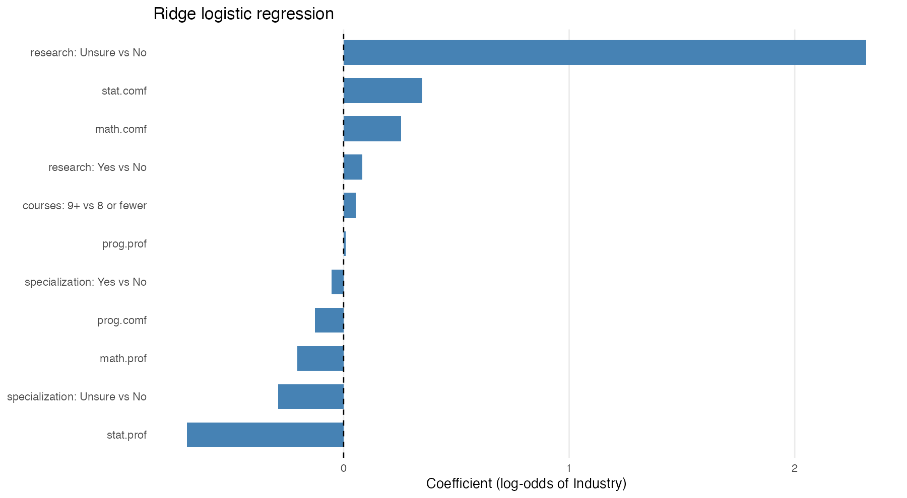
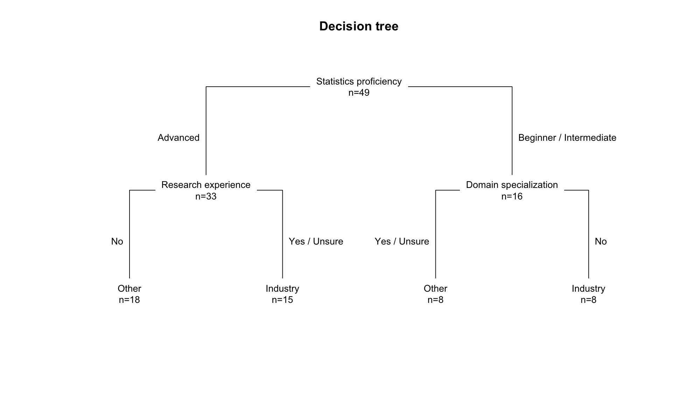

Use this as a template. Keep the headers and remove all other text. Overall, your report may be quite short. When it is complete, render and then push changes to your team repository.

```{r}
# load any other packages and read data here
library(tidyverse)
<<<<<<< HEAD
library(broom)
# loading data and converting profiency metrics to integers
background <- read_csv("../data/background-clean.csv", show_col_types = FALSE) %>%
  mutate(across(ends_with('.prof'),
                ~ match(.x, c('beg', 'int', 'adv')),
                .names = '{.col}.num'),
         prof_avg = (prog.prof.num + math.prof.num + stat.prof.num) / 3)
# One row per student-course pair, trimming spaces from course names
course_long <- background %>%
  select(response_id, courses) %>%
  separate_rows(courses, sep = ',\\s*') %>%
  mutate(courses = str_remove_all(str_trim(courses), ' ')) %>%
  filter(courses != '') %>%
  distinct(response_id, courses)
=======
library(kableExtra)
>>>>>>> 94b1ac5de30b5ccf7bb6852efb1ae8c95d91dba0
```

## Executive summary

Write a one-paragraph abstract summarizing what you did and your findings. It need not be comprehensive; try to highlight the most important or interesting outcomes.

## Data description

Write a brief description of the dataset. Your description should cover how data were obtained, sample characteristics, and measurements taken. It does not need to be exhaustive, but sufficiently detailed to convey a clear high-level understanding of the dataset. You can utilize bullet points or tables if you feel it would help improve clarity.

```{r}
#| label: setup-data-description
#| message: false
#| warning: false
#| echo: false


background <- read_csv('/Users/jocelynlee/Downloads/module0-class-survey-team1/data/background-clean.csv', show_col_types = FALSE)
interest   <- read_csv('/Users/jocelynlee/Downloads/module0-class-survey-team1/data/interest-clean.csv', show_col_types = FALSE)
```

### How the data were obtained

The data come from an intake survey given through Google Forms to students enrolled in PSTAT 197A, the UCSB data science capstone class for Fall Quarter 2026. The survey asked about students' academic backgrounds and their interests related to future capstone projects. It was used to assign students to temporary project teams and to provide the dataset for this analysis.

Every enrolled student was expected to complete the survey as coursework. It was due Sunday, October 4, 2026 at 11:59 p.m. Pacific time.

The course instructor cleaned and de-identified the responses before sharing them. That process included:

- replacing names with artificial respondent IDs to anonymize participants
- removing free-text answers and individual timestamps
- combining the two research-experience questions into one variable
- standardizing spelling variants of major-specific names
- reporting demographics only as class-level counts (i.e. gender and major aren't tied to individual answers)

Other collection details:

- **Collection window:** Responses were submitted between September 23 and October 5, 2026. Almost half (23 of 55) arrived on September 24–25, and the rest were spread across the following week and a half. 54 responses were on time and 1 was submitted after the deadline.
- **Consent:** Students were asked separately whether their responses could be used for the background section and for the project-interest section. Of the 55 respondents, 49 consented to both, 2 consented only to the background section, and 4 consented to neither.
- **De-identification:** Each response's `response_id` doesn't encode identity or submission order. Demographic information can't be linked to individual responses.

### Data files

The two respondent-level files join on `response_id`, which gives 49 students who answered both sections.

| File | Unit | Rows | Contents |
|------------------|------------------|------------------|------------------|
| `background-clean.csv` | Respondent | 51 | Self-rated skills, coursework, domain specialization, research experience |
| `interest-clean.csv` | Respondent | 49 | Project type, programming language, domain and methods interests |
| `class-summary.csv` | Category | — | Aggregate demographics for all 55 respondents (standing, gender, race, majors, consent) |
| `response-timing.csv` | Date | 13 | Number of submissions per day |
| `survey-metadata.csv` | Variable | — | Data dictionary with question wording and coding notes |

### Sample characteristics

The 55 respondents were mostly seniors majoring in Statistics and Data Science.

- **Class standing:** 89.1% seniors, 9.1% juniors, and 1 junior with senior-level credits.
- **Major:** 94.5% Statistics and Data Science. One-third (18 students) reported a second major.
- **Gender:** 54.5% male, 41.8% female, 1 another self-description, 1 preferred not to say.
- **Race/ethnicity:** 67.3% Asian, 14.5% Caucasian, 10.9% multiracial, 1.8% American Indian or Alaska Native, 5.5% preferred not to say.

### Measurements

**Background section (n = 51)**

| Variable | Type | Summary |
|------------------------|------------------------|------------------------|
| Programming, math, and statistics proficiency | Ordinal: beginner / intermediate / advanced, relative to a typical UCSB undergraduate | Statistics was rated highest (65% advanced). Programming was mostly intermediate (63%), and only 3 students rated themselves beginners in anything. |
| Programming, math, and statistics comfort | Ordinal, 1 (least comfortable) to 5 (most comfortable). No student chose 1. | Mean comfort was 3.71 for programming, 3.94 for math, and 4.14 for statistics. |
| Upper-division courses taken | Ordinal: 3–5 / 6–8 / 9+ | 59% reported 9+, 37% reported 6–8, and 4% reported 3–5. |
| Completed courses | Multiple selection from a list | Median of 7 courses selected. The most common were PSTAT 126 (50), PSTAT 120 (49), PSTAT 131 (46), PSTAT 122 (43), and CS 9 (40). |
| Domain specialization | Yes / No / Unsure | 18 Yes, 25 No, 8 Unsure |
| Supervised research experience | Yes / No / Unsure, derived from two questions (data science and non-data-science research, excluding class and personal projects) | 23 Yes, 24 No, 4 Unsure |

**Project-interest section (n = 49)**

| Variable | Type | Summary |
|------------------------|------------------------|------------------------|
| Preferred project type | Categorical: industry / research lab / no preference | 32 industry, 6 research lab, 11 no preference |
| Preferred programming language | Categorical: Python / R / no preference | 22 Python, 11 R, 16 no preference |
| Domains of interest | Multiple selection (e.g., technology, biology, public health), with optional write-ins | — |
| Data science areas of interest | Multiple selection (e.g., predictive modeling, deep learning, NLP) | — |

```{r}
#| label: check-summary-numbers
#| include: false

# Code that produces the numbers in the summary tables above.
# include: false runs it without showing it in the rendered report.

# Joined sample size (49)
background |> inner_join(interest, by = 'response_id') |> nrow()

# Proficiency counts by subject
background |>
  select(prog.prof, math.prof, stat.prof) |>
  pivot_longer(everything(), names_to = "subject", values_to = "level") |>
  count(subject, level)

# Mean comfort by subject
background |>
  summarize(across(c(prog.comf, math.comf, stat.comf), \(x) round(mean(x), 2)))

# Upper-division courses
background |> count(upper_div_courses) |> mutate(percent = round(100 * n / sum(n)))

# Completed courses: median per student and the most common
courses_long <- background |> separate_longer_delim(courses, delim = ", ")
courses_long |> count(response_id) |> summarize(median_courses = median(n))
courses_long |> count(courses, sort = TRUE) |> head(5)

# Domain specialization, research, project type, language
background |> count(domain_specialization)
background |> count(research)
interest |> count(type)
interest |> count(language)
```

## Questions of interest

Indicate the questions your analysis addresses. These should map one-to-one to your findings. Don't include questions you didn't answer or questions you started with and refined later. If you would rather frame them as goals or tasks rather than questions that is okay; just modify the header appropriately. However you frame what you've done, you may only have two or three items; that is fine. Provide an itemized or numbered list so that the reader can easily identify your objectives.

For example:

> *We sought to understand the relationship between coursework preparation, self-assessed technical abilities, and comfort level with technical skills. We also sought to understand whether the relationships differed depending on having had prior research experience. Our analysis addressed three questions:*
>
> 1.  *How should the coursework histories of students in the class be ordered from less preparation to extensive preparation?*
> 2.  *Is coursework preparation associated with increased self-assessed technical skill and comfort within the sample?*
> 3.  *Does prior research experience appear to be a substitute for coursework preparation with respect to self-assessed technical skill and comfort?*
> 3.  What can explain the spikes in when people submitted the survey?

Notice that the questions are precise but not overly technical.

## Findings

Summarize your results. Don't try to explain every step you took; focus instead on providing the main data analytic outputs -- tables and figures -- and explaining clearly what they show. Clarify any important decisions you made in obtaining them. You can display codes if you like but it is not necessary.

<<<<<<< HEAD
Question 1:

Question 1: Which courses are associated with differences in perceived ability?

Sub-question: does the number of upper-division courses taken matter?

As an exploratory analysis we first mapped the number of upper-division courses to self-rated profiency.

```{r}
# set low -> high
proficiency_levels <- c('beg', 'int', 'adv')

# make proficiency ordered factors (beg < int < adv)
background <- background %>%
  mutate(across(ends_with('.prof'),
                ~ factor(.x, levels = proficiency_levels, ordered = TRUE)))

# numeric = 1, int = 2, adv = 3
background <- background %>%
  mutate(across(ends_with('.prof'), as.numeric, .names = '{.col}.num'))

# set up category ranges (3-5 < 6-8 < 9+)
background <- background %>%
  mutate(upper_div_courses = factor(upper_div_courses,
                                    levels = c('3-5', '6-8', '9+'),
                                    ordered = TRUE))
## EDA: proficiency by number of upper-division courses -----------------------
background %>%
  select(upper_div_courses, prog.prof, math.prof, stat.prof) %>%
  pivot_longer(-upper_div_courses, names_to = 'skill', values_to = 'level') %>%
  mutate(skill = recode(skill, prog.prof = 'Programming',
                        math.prof = 'Math', stat.prof = 'Statistics'),
         skill = factor(skill, levels = c('Programming', 'Math', 'Statistics'))) %>%
  ggplot(aes(x = upper_div_courses, fill = level)) +
  geom_bar(position = position_fill(reverse = TRUE)) +   # beg at bottom
  facet_wrap(~ skill) +
  scale_x_discrete(labels = c('3-5' = '3-5\n(n=2)',       # show group sizes
                              '6-8' = '6-8\n(n=19)',
                              '9+'  = '9+\n(n=30)')) +
  scale_y_continuous(labels = scales::percent) +
  scale_fill_manual(values = c(beg = '#E69F00',
                               int = '#999999',
                               adv = '#0072B2'),
                    labels = c(beg = 'Beginner',
                               int = 'Intermediate',
                               adv = 'Advanced')) +
  labs(x = 'Upper-division courses taken', y = 'Proportion of students',
       fill = 'Proficiency',
       title = 'Self-rated proficiency by number of upper-division courses') +
  theme_minimal()
```

There looks to be some correlation with proficiency and number of upper div classes taken before the capstone series statistics had more advance scores, this makes sense since most of the class body are statistics majors. Programming had the only beginner responses among the lower end upper div classes taken this makes sense as there are not many programming-centric classes in the PSTAT department, most of R or python could have been learned throughout the major rather than in specific classes.

For the main analysis of analyzing what courses correlate to difference in perceived ability, we first looked at the course list. We dropped PSTAT 120, 122, and 126 as nearly all student took them, and so the , we also dropped courses taken by 3 or fewer students(LING 110, LING 104, GEOG 186, CS 130), as that many students wouldn't be a large enough sample size to produce some inference.

```{r}
course_wide <- course_long %>%
  mutate(taken = 1) %>%
  pivot_wider(names_from = courses, values_from = taken, values_fill = 0)

q1_data <- background %>%
  select(response_id, prof_avg, ends_with('.prof.num')) %>%
  left_join(select(course_wide, response_id, all_of(keep_courses)),
            by = 'response_id')
```

We decided to use regression as each course can become a binary explanatory variable; taken/not taken can become 0 and 1 respecively, so courses can be used directly as predictors of perceived ability. Additionally, multiple regression compares all courses at once: each coefficient is the difference in proficiency for taking that course, holding the other courses constant, which separates courses that are often taken together coefficients are on the same scale, so they can be ranked to see which course is associated with the largest difference even without statistical significance, the size and direction of the estimates give insight into which courses may relate to perceived ability, and which results rest on too few students to trust.

```{r}
course_wide <- course_long %>%
  mutate(taken = 1) %>%
  pivot_wider(names_from = courses, values_from = taken, values_fill = 0)

q1_data <- background %>%
  select(response_id, ends_with('.prof.num')) %>%
  left_join(select(course_wide, response_id, all_of(keep_courses)),
            by = 'response_id')
```

```{r}
# fitting overall and individual skills into one outcome variable
outcomes <- c(Overall     = 'prof_avg',
              Programming = 'prog.prof.num',
              Math        = 'math.prof.num',
              Statistics  = 'stat.prof.num')

models <- map(outcomes,
              ~ lm(reformulate(keep_courses, response = .x), data = q1_data))

summary(models$Overall)   # main model: overall p-value, adjusted R^2
```

At first, we decided to use the proficiency average, so then we could just use one model to see if any courses made a statistically significant difference in all perceived proficiencies.

From the model, no course showed a statistically significant difference in prof_avg (all p \> 0.05) PSTAT 131 had the largest difference (+0.37, p = 0.06), but only 5 of 51 students had not taken it, so the estimate compares 46 students to 5 and is not reliable the overall model was not significant (p = 0.47, adjusted R\^2 \~ 0).  There are two possible explanations:

   1. small sample (n = 51, 11 predictors) -\> too little power to detect effects

   2. courses taken may have little connection to self rated proficiency

Since there was no course that showed a statistically significant difference in the proficiency, we then thought there could be a difference in the individual perceived proficiences.

```{}
```

```{r}
coefs %>%
  filter(model != 'Overall') %>%
  ggplot(aes(x = estimate, y = fct_reorder(term, estimate))) +
  geom_vline(xintercept = 0, linetype = 'dashed', color = 'gray50') +
  geom_errorbar(aes(xmin = conf.low, xmax = conf.high),
                width = 0.2, orientation = 'y') +
  geom_point(size = 2, color = '#0072D3') +
  facet_wrap(~ model) +
  labs(x = 'Difference in proficiency (took vs. did not take)', y = NULL,
       title = 'Course-taking and self-rated proficiency by subject') +
  theme_minimal()
```

Looking at the graph, we can see 3 categories for each prof. metric as well as a list of all relevant courses, and for each course there is a 95% percent confidence interval for their coefficients. Looking at significance, Statistics is the only panel with a hint of signal: PSTAT 115 (+0.53, p = 0.055) and PSTAT 131 (+0.44, p = 0.063). Both are above the 0.05 cutoff, and both rest on small comparison groups (7 takers for 115, 5 non-takers for 131), thus their intervals are wide. Programming: PSTAT 134 is highest among the well-sized courses (+0.30, p = 0.17). It's plausible that PSTAT134 has an effect, since it is one of the more applied courses, but the interval still does includes zero.

Overall, there is no clear evidence that any single course, or the number of upper div courses,is associated with higher self-rated proficiency in this sample; the only hints are statistics specific (PSTAT 115, 131) and rest on small groups.
=======

### Q3 Findings: Survey Submission Timing

### Survey submission timing


Background info: The survey was assigned at the first lecture (Thu Sep 24) and reminded in the next lecture, section and lecture (Tue Sep 29, Wed Sep 30, Thu Oct 1). It was due Sun Oct 4 at 11:59 PM.

```{r echo=FALSE label=timing-setup}
library(broom)

timing <- read_csv('../data/response-timing.csv', show_col_types = FALSE)

# class calendar from the course website (not part of the survey data)
assigned_date  <- as.Date('2026-09-24')
reminder_dates <- as.Date(c('2026-09-29', '2026-09-30', '2026-10-01'))
deadline_date  <- as.Date('2026-10-04')

timing <- timing %>%
  mutate(weekday = wday(date, label = TRUE),
         weekend = weekday %in% c('Sat', 'Sun'),
         day_type = case_when(
           date <  assigned_date ~ 'Before first class',
           date == assigned_date ~ 'Assigned in class',
           date %in% reminder_dates ~ 'Reminder in class/section',
           date >  deadline_date ~ 'After deadline',
           TRUE ~ 'No class contact'))

# response window: assignment day through deadline (11 days, 53 responses)
window <- timing %>%
  filter(date >= assigned_date, date <= deadline_date) %>%
  mutate(contact = case_when(
    date == assigned_date ~ 'Assigned (Thu Sep 24)',
    date == reminder_dates[1] ~ 'First reminder (Tue Sep 29)',
    date %in% reminder_dates[-1] ~ 'Later reminders (Wed Sep 30, Thu Oct 1)',
    TRUE ~ 'None') %>% fct_relevel('None'))
```

```{r}
#| label: fig-timing
#| fig-cap: "Daily survey submissions. The class calendar comes from the course website, not the survey data."
#| fig-width: 8
#| fig-height: 4.5
fill_cols <- c('Assigned in class' = '#2a78d6',
               'Reminder in class/section' = '#FFA500',
               'No class contact' = 'grey70',
               'Before first class' = 'grey85',
               'After deadline' = 'grey85')

ggplot(timing, aes(x = date, y = n)) +
  geom_col(aes(fill = day_type), width = 0.8) +
  geom_vline(xintercept = assigned_date - 0.5, linetype = 'dashed', colour = 'grey40') + 
  annotate('text', x = assigned_date - 0.6, y=14, label = 'Assigned Date\nThur Sep 24',
           hjust = 1, size=3.2, colour = 'grey30') + 
  geom_vline(xintercept = deadline_date + 0.5, linetype = 'dashed', colour = 'grey40') +
  annotate('text', x = deadline_date + 0.4, y = 14, label = 'Deadline\nSun Oct 4',
           hjust = 1, size = 3.2, colour = 'grey30') +
  geom_text(aes(label = n), vjust = -0.4, size = 3.2, colour = 'grey20') +
  scale_fill_manual(values = fill_cols, breaks = names(fill_cols)[1:3], name = NULL) +
  scale_x_date(date_breaks = '1 day', date_labels = '%a\n%b %d', expand = expansion(add = 0.6)) +
  scale_y_continuous(expand = expansion(mult = c(0, 0.08))) +
  labs(x = NULL, y = 'Survey responses submitted',
       title = 'Responses spiked on the days the survey was announced in class') +
  theme_minimal(base_size = 11) +
  theme(legend.position = 'top', panel.grid.major.x = element_blank(),
        panel.grid.minor = element_blank())
```

Responses came in arguably two to three waves. Two of them happening on a day the survey was mentioned in class. The first class, Thursday, Sep. 24, brought in 15 responses (close to 30% of the class). The following day, Friday Sep. 25, brought on a new wave of responses, summoning 8 more responses. Hence, in roughly 24 hours since the assignment was announced, roughly 44% of the class had completed the survey. The next in-class session/reminder was on Tuesday, Sep. 29, accumulating 10 more responses. This turned the total cumulative percentage of students who completed the survey to 78%. Students did not procrastinate and only 3 responses came in on the deadline (Sunday Oct 4), and one late response (Monday Oct 5). Both are left out of the analysis.

```{r}
#| label: timing-chisq
set.seed(197)
gof <- chisq.test(window$n, simulate.p.value = TRUE, B = 10000)
```

To check whether responses could have been spread evenly across the window, we compared the daily counts with an even split of about 4.8 per day. We used a simulated p-value because the expected daily counts are too small for the standard chi-squared approximation.

```{r}
#| label: tbl-timing-model
#| tbl-cap: "Quasi-Poisson models of daily submissions, Sep 24 to Oct 4 (11 days). Estimates are rate ratios relative to days with no class contact; the intercept is responses per day on such a day. 95% intervals in parentheses."
fit_main    <- glm(n ~ contact,           family = quasipoisson, data = window)
fit_weekend <- glm(n ~ contact + weekend, family = quasipoisson, data = window)

fmt <- function(fit) {
  tidy(fit, exponentiate = TRUE, conf.int = TRUE) %>%
    mutate(value = sprintf('%.2f (%.2f, %.2f)', estimate, conf.low, conf.high)) %>%
    select(term, value)
}

full_join(fmt(fit_main), fmt(fit_weekend), by = 'term') %>%
  mutate(term = term %>%
           str_remove('^contact') %>%
           str_replace('\\(Intercept\\)', 'Baseline: responses per day') %>%
           str_replace('weekendTRUE', 'Weekend day'),
         across(everything(), ~ replace_na(.x, '-'))) %>%
  knitr::kable(col.names = c('', 'Class contact only', 'Adding weekend'))
```

Used two quasi-poisson models.The "class contact" column predicts daily responses from the type of day: day assigned, first reminder, later reminders, or no class contact. The second column "Adding weekend" is the same model plus a yes/no weekend term. Note, every other row besides "baseline" is a multiplier on that baseline.

The class contact column identifies an "ordinary day" as a weekday or weekend with no class contact. A baseline tells us there is about \~3.3 responses on an ordinary day (no class contact). The Assigned row tells us there were times 4.6 more responses on the Assigned day. The conf interval being well above 1 means the spike is clear (if it includes 1, the data can't rule out as "no effect"). The first reminder had 3.3 times more than an ordinary day. The later responses were no different from an ordinary day.

Some of the days without class contact were weekends, which may be slow for other reasons. Hence, we re-fit the model with a weekend indicator. The assignment day held up (\~3.2 times an ordinary weekday) however, the first reminder diminished to x2.1 times, and the conf interval now includes 1.

We conclude that the survey announcement clearly drove the first wave. The first reminder probably helped, but these data can’t separate its effect from the usual weekday-to-weekend pattern. Later reminders added little.

## Finding Q2

For our second question, we first performed exploratory data analysis on the two variables of interest (`research`, `type`). These two variables are categorical, hence the use of bar charts and count tables in our analysis. We found that the data set was uneven in the distribution of those who preferred industry to lab research, but balanced in whether or not the students had research experience. The counts are available in the tables below:

```{r}
background <- read_csv('../data/background-clean.csv', show_col_types = FALSE)
interest <- read_csv('../data/interest-clean.csv', show_col_types = FALSE)

joint <- background |> 
  inner_join(interest, by = 'response_id')

joint |> group_by(type) |> 
  count() |> 
  kable()

joint |> group_by(research) |> 
  count() |> 
  kable()
```

Additionally, here are the bar graphs of their distributions:

```{r}
ggplot(joint, aes(x = type)) +
  geom_bar(fill = "steelblue")

ggplot(joint, aes(x = research)) +
  geom_bar(fill = "coral")
```

For our bivariate analysis we made a contingency table and stacked bar chart to see if there was any noticeable change in likelihood for being interested in research. The figures are shown below:

```{r}
# Contingency table of the two variables
table(joint$research, joint$type) |> 
  kable()

ggplot(joint, aes(x = type, fill = research)) +
  geom_bar() +
  labs(
    x = "Preferred Project",
    y = "COunt",
    fill = "Did Research?"
  )
```

It's hard to see if there's a difference in proportion so we also made a proportion bar chart:

```{r}
ggplot(joint, aes(x = type, fill = research)) +
  geom_bar(position = "fill") +
  labs(
    x = "Preferred Project",
    y = "Frequency",
    fill = "Did Research?"
  )
```

Based on this bar chart, doing research does not seem to significantly affect project preference. Something worth pointing out is that the proportion is very similar for those who did research across all project preference groups. However, for those who preferred industry, there was a lower proportion of people who definitively did research that is made up for by those who were unsure of if they did research or not.

Next, we did hypothesis testing to see if there was any evidence to support a correlation between the two variables. Our null hypothesis is H0: project preference and research experience are independent. Our alternative hypothesis is HA: project preference and research experience are associated. Initially, we used Pearson's Chi-squared test. However, since only 6 observations recorded that they preferred research, there was not enough observations per unique value for it to be a reliable test. Therefore, we went with Fisher's Exact Test.

```{r}
fisher.test(joint$research, joint$type)
```

We obtained a p-value of 0.8424 \> 0.05. Since the p-value is higher than our rejection threshold, we fail to reject H0. There is not enough evidence to suggest that project preference is influenced by whether or not the person did research.

Expanding on the second question,we next examined whether research experience combined with other background variables could predict an explicit preference for industry projects. To do this, we fit ridge logistic regression and a shallow classification tree. Among the 49 respondents, 32 preferred industry, while 17 preferred lab projects or reported no preference. Both models used the same predictors, balanced class weights, and a 0.5 classification threshold. Predictive performance was evaluated using five-fold cross-validation repeated ten times.

| Model                     | Accuracy | Balanced accuracy |   AUC |
|---------------------------|---------:|------------------:|------:|
| Always predict Industry   |    65.3% |             50.0% | 0.500 |
| Ridge logistic regression |    36.3% |             33.9% | 0.335 |
| Shallow decision tree     |    42.2% |             41.3% | 0.358 |

The decision tree performed better than logistic regression across all three metrics, but neither model outperformed the majority-class baseline. Balanced accuracy remained below 50%, and AUC values below 0.5 indicated poor discrimination between the two preference groups. To evaluate model significance, we conducted 499 label permutations, refitting both models through the same validation procedure. The one-sided tests provided no evidence of above-null balanced accuracy ($p = 0.972$ for logistic regression; $p = 0.872$ for the tree). Both Benjamini–Hochberg-adjusted p-values were 0.972.

The full-data fits showed several descriptive patterns. In the ridge model, uncertainty about prior research experience was associated with higher predicted industry preference relative to reporting no research experience, holding other predictors constant. Statistics proficiency had a negative coefficient. The tree first separated advanced statistics proficiency ($n = 33$) from beginner or intermediate proficiency ($n = 16$), then split on research experience and domain specialization. These fitted relationships did not translate into effective out-of-sample prediction. Other parameter settings were also explored without a consistent improvement over the baseline.




>>>>>>> 94b1ac5de30b5ccf7bb6852efb1ae8c95d91dba0

## Useful tips (remove this section)

Due to the visual editor, most common needs for authoring can be met using menu items in the RStudio IDE. For a comprehensive guide to Quarto, see the [documentation](https://quarto.org/docs/guide/); consult the documentation for anything you can't sort out in the IDE.

### Code chunks

Insert code chunks using the *Insert* drop-down menu or `ctrl + alt + I` . By default in this document, codes will not be shown but results will. If you want to change this behavior, add the chunk option `echo: true` as below.

```{r}
#| echo: true
my_df <- tibble(animal = c('snake', 'gecko'),
                threatening = c(TRUE, FALSE))

my_df
```

Code chunks will be executed in order when the document is rendered, so packages should be loaded at the very beginning of the document

### Rendering tables in markdown

Several functions exist for converting dataframes to markdown tables for nice display. A simple one from the `knitr` package is `knitr::kable()` .

```{r}
my_df %>% knitr::kable()
```

### Figures

To include any figures not generated by code chunks, use *Insert \> Figure / Image* or `` .

Most of the time code chunks producing plots will render fine. However, to adjust sizing or alignment, use the chunk options `fig-width` and `fig-height` . Captions can be added with `fig-cap` .

```{r}
#| fig-width: 4
#| fig-height: 3
#| fig-align: left
#| fig-cap: A terrible plot.

my_df %>% 
  ggplot(aes(x = animal, y = threatening)) + 
  geom_col()
```

### Links

To include any hyperlinks, use `[display text](url)` .
